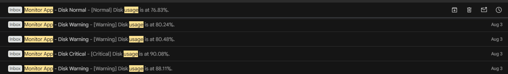
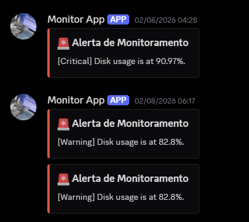
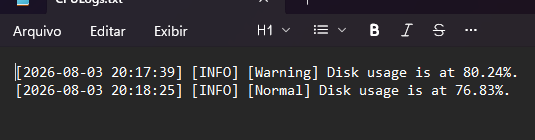

# PowerShell System Monitor

A PowerShell script that monitors CPU, memory and disk usage on a Windows machine and sends alerts to Email, Slack, Discord and Microsoft Teams when usage crosses configurable thresholds.

## Features

- Monitors CPU, memory and disk usage through CIM (`Get-CimInstance`)
- Two severity levels per metric (Warning and Critical), defined in `config.json`
- Sends an alert only when a metric changes level, including when it returns to Normal, so a sustained high value does not generate repeated notifications
- Each notification channel can be enabled or disabled independently
- A failure collecting one metric, or sending to one channel, does not stop the others; errors are written to the log file
- Console output on every check and a persistent log file

## How it works

Every `CheckInterval` seconds the script reads CPU, memory and disk usage and converts each value into a level (Normal, Warning or Critical) using the configured thresholds. It then compares that level with the last known level of the same metric. If the level changed, `Send-Alert` writes the event to the log and sends the message to every enabled channel.

Alert message format:

```
[Warning] Disk usage is at 80.48%.
```

## Requirements

- Windows with Windows PowerShell 5.1 (tested on 5.1.26100)
- The `Send-MailKitMessage` module, only if the Email channel is enabled:

```powershell
Install-Module -Name Send-MailKitMessage -Scope CurrentUser
```

## Setup

1. Clone the repository:

```powershell
git clone https://github.com/jarbas-abreujr/powershell-system-monitor.git C:\MonitorApp
cd C:\MonitorApp
```

2. Copy the example configuration file:

```powershell
Copy-Item .\config.example.json .\config.json
```

3. Edit `C:\MonitorApp\config.json`: adjust the thresholds, then set `Enabled` to `true` and fill in the details of each channel you want to use.

4. Run the script:

```powershell
powershell -ExecutionPolicy Bypass -File .\Monitor.ps1
```

The log is written to `C:\MonitorApp\Logs\CPULogs.txt`, and the folder is created automatically. Both the log and config paths are defined at the top of the script.

## Setup

1. Clone the repository:

```powershell
git clone https://github.com/jarbas-abreujr/powershell-system-monitor.git C:\MonitorApp
cd C:\MonitorApp
```

2. Copy the example configuration file:

```powershell
Copy-Item .\config.example.json .\config.json
```

3. Edit `C:\MonitorApp\config.json`: adjust the thresholds, then set `Enabled` to `true` and fill in the details of each channel you want to use.

4. Run the script:

```powershell
powershell -ExecutionPolicy Bypass -File .\Monitor.ps1
```

The log is written to `C:\MonitorApp\Logs\CPULogs.txt`, and the folder is created automatically. Both the log and config paths are defined at the top of the script.

## Configuration

| Field | Description |
| --- | --- |
| `CheckInterval` | Seconds between checks |
| `Thresholds.CPU`, `Thresholds.Memory`, `Thresholds.Disk` | `Warning` and `Critical` usage percentages for each metric |
| `DiskPath` | Drive to monitor, for example `C:\\` (backslashes are escaped in JSON) |
| `Alerts.<Channel>.Enabled` | `true` to send alerts through that channel |
| `Alerts.Email` | `SmtpServer`, `SmtpPort`, `From`, `To`, `Username`, `Password` |
| `Alerts.Slack`, `Alerts.Teams`, `Alerts.Discord` | `WebhookUrl` |

`config.json` contains credentials and is listed in `.gitignore`. Only `config.example.json`, which has placeholder values, belongs in the repository.

## Notification channels

| Channel | Method | Status |
| --- | --- | --- |
| Email | SMTP through MailKit | Tested with Gmail using an app password |
| Discord | Webhook with an embed message | Tested |
| Slack | Incoming webhook | Implemented following Slack's webhook format; not tested against a live workspace |
| Teams | Workflows webhook with an Adaptive Card | Implemented following Microsoft's documentation; not tested, as it requires a Microsoft 365 work or school account |

Gmail requires 2-step verification and an app password. The regular account password does not work for SMTP.

## Example output

Console:

```
CPU: 12% [Normal]
Memory: 58.4% [Normal]
Disk: 90.08% [Critical]
```

Log:

```
[2026-08-03 19:59:10] [INFO] [Warning] Disk usage is at 80.35%.
```

Alerts received by email and on Discord:





Log File output:



## Limitations and next steps

- Windows only, since the metrics come from CIM
- Credentials are stored in plain text in `config.json`; a secret store such as PowerShell SecretManagement would be safer
- The script runs while its console is open; for continuous monitoring it should run as a scheduled task
- Every enabled channel receives every alert; routing by severity (for example, Critical only by email) is not implemented
